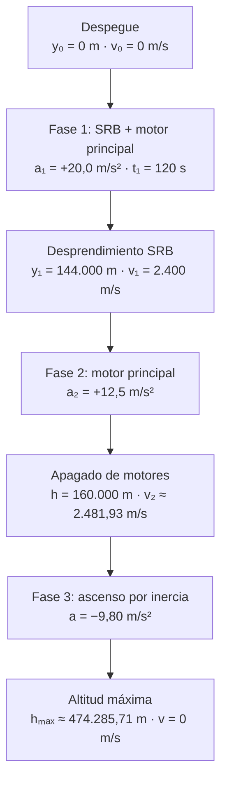
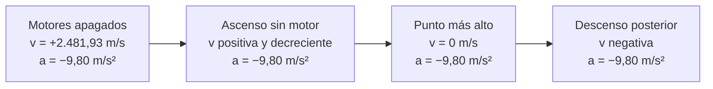

# Artemis I — Escenario 1: Ascenso y propulsión del SLS

> **Algoritmos y Estructuras de Datos - Laboratorio C**  
> Universidad Tecnológica Nacional — Facultad Regional Resistencia  
> **Documento:** planteo y resolución física del problema, previo a la implementación algorítmica.

## 1. Situación planteada

El cohete **Space Launch System (SLS)** despega verticalmente desde el Centro Espacial Kennedy llevando a la nave **Orion**. Parte del reposo desde la plataforma de lanzamiento.

El modelo divide el movimiento en tres etapas:

1. **Fase 1 — Ascenso con propulsores SRB:** aceleración constante de **20,0 m/s²** durante **120,0 s**.
2. **Fase 2 — Ascenso con motor principal:** tras el desprendimiento de los SRB, aceleración constante de **12,5 m/s²** hasta una altitud de **160.000 m**.
3. **Fase 3 — Ascenso sin propulsión:** al apagarse los motores, la nave continúa subiendo por inercia mientras la gravedad terrestre la desacelera, hasta alcanzar velocidad vertical cero.

Se desprecia la resistencia del aire. Para la tercera fase se considera una gravedad constante de **9,80 m/s²**.

### Datos iniciales

| Magnitud | Símbolo | Valor | Unidad |
|:--|:--:|--:|:--|
| Velocidad inicial | $v_0$ | 0 | m/s |
| Altitud inicial | $y_0$ | 0 | m |
| Aceleración en fase 1 | $a_1$ | 20,0 | m/s² |
| Tiempo hasta desprendimiento | $t_1$ | 120,0 | s |
| Aceleración en fase 2 | $a_2$ | 12,5 | m/s² |
| Altitud de apagado | $h$ | 160.000,0 | m |
| Gravedad terrestre (módulo) | $g$ | 9,80 | m/s² |

**Convención de signos:** tomamos el eje vertical positivo hacia arriba. Por eso, durante el ascenso propulsado las aceleraciones indicadas son positivas, y después del apagado la aceleración gravitatoria es $a=-g=-9,80\ \text{m/s}^2$.

## 2. Diagrama de etapas

> **Importante:** el apagado de motores no implica velocidad cero. La nave sigue ascendiendo, aunque su velocidad disminuye por acción de la gravedad.

## 3. Pregunta A — Velocidad y altitud al desprendimiento

**¿Qué rapidez y qué altitud alcanza la nave a los 120 segundos?**

La primera fase es un **movimiento rectilíneo uniformemente variado (MRUV)**: la aceleración es constante.

### Rapidez al desprendimiento

$$
v_1=v_0+a_1t_1
$$

$$
v_1=0+(20,0)(120,0)=\boxed{2.400\ \text{m/s}}
$$

### Altitud al desprendimiento

Como la aceleración es constante, la velocidad media de la fase es el promedio de la inicial y la final:

$$
y_1=y_0+\frac{v_0+v_1}{2}\,t_1
$$

$$
y_1=0+\frac{0+2.400}{2}\cdot120=\boxed{144.000\ \text{m}}
$$

**Resultado A:** rapidez de **2.400 m/s** y altitud de **144 km**.

> **Rapidez y velocidad:** la rapidez es el módulo de la velocidad. En este ascenso vertical, la velocidad es positiva y su módulo coincide numéricamente con la rapidez.

## 4. Pregunta B — Rapidez al apagado de motores

**¿Qué rapidez alcanza Orion al llegar a 160.000 m?**

La segunda fase comienza con la velocidad adquirida en la primera: **no parte del reposo**.

| Magnitud | Valor |
|:--|--:|
| Velocidad inicial de fase 2 | 2.400 m/s |
| Altitud inicial de fase 2 | 144.000 m |
| Altitud final de fase 2 | 160.000 m |
| Aceleración de fase 2 | +12,5 m/s² |

El desplazamiento es:

$$
\Delta y_2=160.000-144.000=16.000\ \text{m}
$$

Como no conocemos el tiempo de la segunda fase, utilizamos la ecuación de MRUV independiente del tiempo:

$$
v_2^2=v_1^2+2a_2\Delta y_2
$$

$$
v_2^2=(2.400)^2+2(12,5)(16.000)
$$

$$
v_2^2=5.760.000+400.000=6.160.000
$$

$$
v_2=\sqrt{6.160.000}=\boxed{2.481,93\ \text{m/s}}
$$

**Resultado B:** rapidez al apagado de aproximadamente **2.481,93 m/s**.

> **Nota de precisión:** conservamos $v_2^2=6.160.000\ \text{m}^2/\text{s}^2$ para el cálculo siguiente, evitando errores por redondear antes de tiempo.

## 5. Pregunta C — Altitud máxima tras el apagado

**¿Hasta qué altura continúa subiendo Orion si, al apagarse los motores a 160.000 m, solo actúa la gravedad?**

Esta etapa corresponde al **módulo 4** del proyecto.

### Interpretación física

- En el apagado, la nave **todavía asciende** con velocidad inicial $v_2$.
- Sin empuje, la aceleración vertical pasa a ser **$-9,80\ \text{m/s}^2$**.
- Mientras asciende, su velocidad disminuye.
- En el punto más alto, la **velocidad instantánea es cero**, pero la **aceleración sigue siendo $-9,80\ \text{m/s}^2$**.
- Luego comienza a descender.

### Desarrollo

Aplicamos nuevamente la ecuación de MRUV sin tiempo:

$$
v_f^2=v_i^2+2a\Delta h
$$

En el punto más alto, $v_f=0$ y $a=-g$:

$$
0=v_2^2-2g\Delta h
$$

Despejando el ascenso adicional:

$$
\Delta h=\frac{v_2^2}{2g}
$$

Sustituyendo los valores:

$$
\Delta h=\frac{6.160.000}{2(9,80)}=\boxed{314.285,71\ \text{m}}
$$

La pregunta solicita la **altitud máxima respecto de la plataforma**, no solo la distancia recorrida después del apagado:

$$
h_{\max}=h+\Delta h
$$

$$
h_{\max}=160.000+314.285,71=\boxed{474.285,71\ \text{m}}
$$

**Resultado C:** la nave alcanza una altitud máxima de aproximadamente **474,29 km** respecto de la plataforma.

### Diferencia entre velocidad y aceleración

| Estado | Velocidad vertical | Aceleración vertical |
|:--|:--|:--|
| Al apagar motores | Positiva | −9,80 m/s² |
| Mientras sigue subiendo | Positiva y disminuyendo | −9,80 m/s² |
| En la altura máxima | Cero | −9,80 m/s² |
| Al comenzar a caer | Negativa | −9,80 m/s² |

La gravedad **desacelera durante el ascenso** y **aumenta la rapidez durante el descenso**, aunque la aceleración gravitatoria mantiene el mismo valor y sentido en todo este modelo.

## 6. Pregunta D — Aceleración expresada en múltiplos de g

**¿A cuántas veces la gravedad terrestre equivale la aceleración de la primera fase?**

La aceleración neta de la primera fase es $a_1=20,0\ \text{m/s}^2$:

$$
\frac{a_1}{g}=\frac{20,0}{9,80}=\boxed{2,04\ g}
$$

**Resultado D (aceleración neta): 2,04 g.**

**Distinción física:** si se pregunta por la **carga aparente que siente la tripulación** debido a la fuerza del asiento, bajo el modelo vertical simplificado resulta:

$$
\frac{a_1+g}{g}=\frac{20,0+9,80}{9,80}=\boxed{3,04\ g}
$$

Son dos magnitudes diferentes: **2,04 g de aceleración neta** y **3,04 g de carga aparente**. El enunciado puede interpretarse de ambas maneras, por lo que conviene distinguirlas al presentar la respuesta.

## 7. Resultados finales

| Pregunta | Magnitud | Resultado |
|:--:|:--|--:|
| A | Rapidez al desprendimiento | **2.400 m/s** |
| A | Altitud al desprendimiento | **144.000 m (144 km)** |
| B | Rapidez al apagado | **2.481,93 m/s** |
| C | Ascenso adicional sin propulsión | **314.285,71 m** |
| C | Altitud máxima respecto de la plataforma | **474.285,71 m (474,29 km)** |
| D | Aceleración neta de fase 1 | **2,04 g** |
| D | Carga aparente en fase 1 | **3,04 g** |

## 8. Supuestos y límites del modelo

1. El movimiento se considera **vertical y rectilíneo**.
2. La nave parte del reposo y de altitud cero.
3. Las aceleraciones de las fases propulsadas se interpretan como **aceleraciones netas constantes**, tal como se emplean en el planteo.
4. Se **desprecia la resistencia del aire**.
5. Tras el apagado, la única aceleración considerada es la gravedad terrestre, **constante e igual a 9,80 m/s²**. En la realidad, la gravedad disminuye con la altitud.
6. Los cálculos describen un **modelo académico simplificado**, no una predicción real de la trayectoria de Artemis.
7. Los valores mostrados se redondean solo al presentar resultados; se evita redondear los cálculos intermedios.

## 9. Relación con el desarrollo en C

Este documento establece la **base física** de la simulación. La implementación algorítmica se realizará por módulos, de acuerdo con la organización acordada por el equipo:

| Módulo | Responsabilidad |
|:--:|:--|
| 1 | Entrada y validación de datos |
| 2 | Fase 1 y control de coherencia |
| 3 | Fase 2 y rapidez al apagado |
| **4** | **Ascenso sin propulsión y cálculo de altitud máxima** |
| 5 | Aceleración en múltiplos de g y presentación de resultados |

**Caso especial a contemplar en el programa:** si con valores ingresados por el usuario la nave alcanza la altitud de apagado antes del desprendimiento de los SRB, la fase 2 no existe. El programa debe calcular la rapidez de apagado de forma coherente y el módulo 4 utilizar esa rapidez efectiva.

---

**Fuente del escenario:** consigna del *Trabajo Práctico Integrador Final — Simulador de Misiones Artemis (Lenguaje C)*, UTN Facultad Regional Resistencia, Situación-Problema 1. Los desarrollos y diagramas de este documento son una explicación de las ecuaciones aplicadas al escenario.
