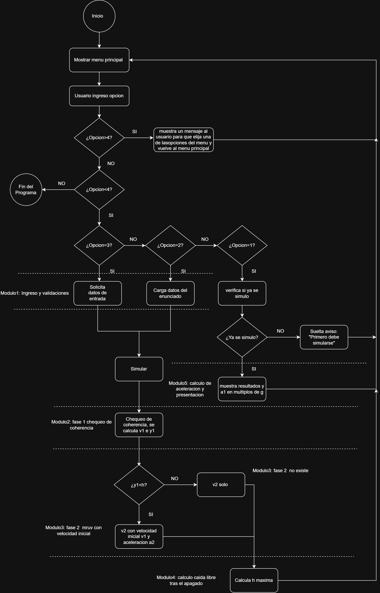

# ACDC
Laboratorio C de algoritmos y estructura de datos - ISI D - Escenario 1

Integrantes:
- Cabral Viola, Luka
- Sanabria, Lucas German
- Ramirez, Zahira Nahir
- Vicentin, Valentina
- González, Maria Teresa

Descripción del Escenario 1: El sistema interactivo que desarrollamos en lenguaje C simula el ascenso y propulsión del cohete Space Launch System (SLS) con la nave Orion. El programa calcula:
-La rapidez y altitud al momento del desprendimiento de los cohetes SRB (Fase 1).
-La rapidez final al apagar los motores a 160 km de altitud (Fase 2).
-La altitud máxima alcanzada en caso de un ascenso balístico por inercia/caída libre.
-La aceleración expresada en múltiplos de la gravedad ($g$) y la carga aparente percibida por la tripulación.

Arquitectura Modular El proyecto está dividido en módulos independientes para cumplir con las prácticas de programación estructurada:
-main.c: Menú interactivo por consola y control del flujo general.
-artemis.c / artemis.h: Lógica de negocio, cálculos físicos y estructuración de datos.
-validaciones.c / validaciones.h: Funciones de ingreso seguro de datos, soporte de comas/puntos y control de errores ante entradas erróneas del usuario.

Registro de Uso de Inteligencia Artificial:
Herramientas utilizadas: Asistente IA Geminis
Tareas específicas:
-Asistencia en la estructuración de la modularización en archivos .c y .h.
-Optimización de funciones de validación segura de entradas (fgets / strtol).
-Revisión de casos de prueba físicos basados en las ecuaciones del enunciado.
-Validación: Todo el código generado por IA fue revisado, comprendido, integrado y adaptado por nosotros para garantizar su correcto funcionamiento y cumplimiento con los parámetros de la cátedra de Algoritmos y Estructuras de Datos.

## Diagrama de flujo del programa

*Figura 1: flujo del menú principal y de los módulos de la simulación.*
