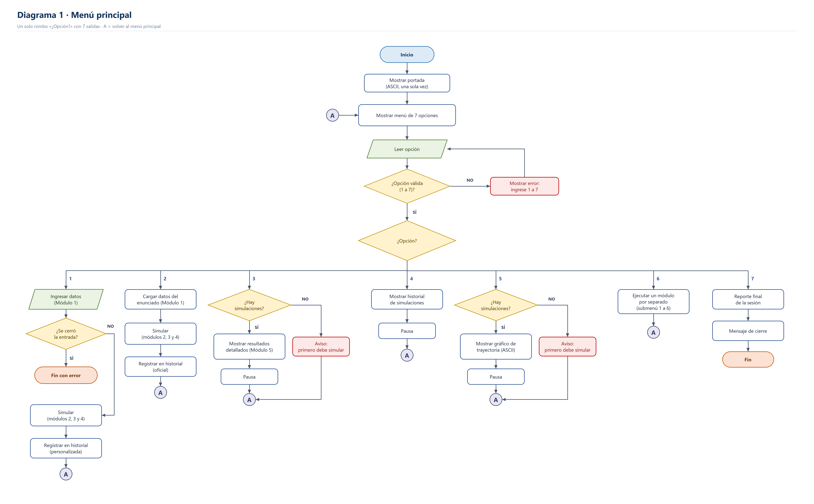
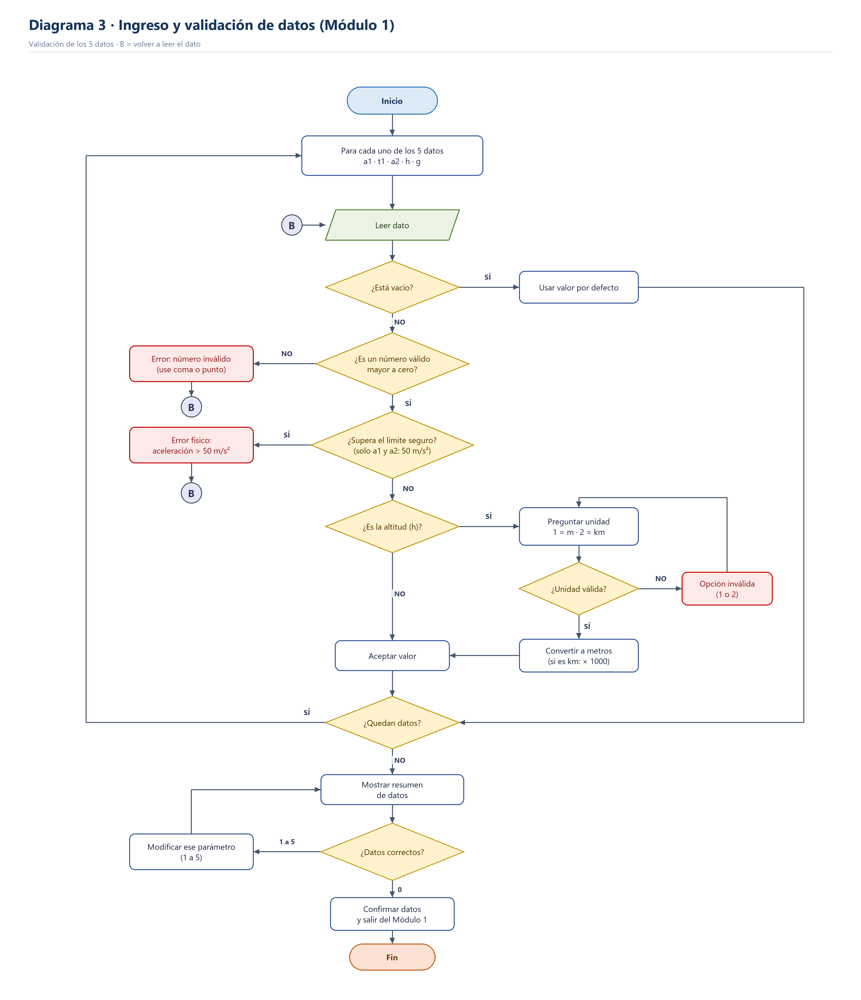

# ACDC

Laboratorio C de algoritmos y estructura de datos - ISI D - Escenario 1

Integrantes:

- Cabral Viola, Luka
- Sanabria, Lucas German
- Ramirez, Zahira Nahir
- Vicentin, Valentina
- González, María Teresa

Descripción del Escenario 1:
El sistema interactivo que desarrollamos en lenguaje C simula el **ascenso y propulsión del cohete Space Launch System (SLS)** con la nave Orion. El programa calcula:

- La rapidez y altitud al momento del desprendimiento de los cohetes SRB (Fase 1).
- La rapidez final al apagar los motores a 160 km de altitud (Fase 2).
- La altitud máxima alcanzada en caso de un ascenso balístico por inercia/caída libre.
- La aceleración expresada en múltiplos de la gravedad ($g$) y la carga aparente percibida por la tripulación.

Arquitectura Modular
El proyecto está dividido en módulos independientes para cumplir con las prácticas de programación estructurada:

- **`main.c`**: Menú interactivo por consola y control del flujo general.
- **`artemis.c` / `artemis.h`**: Lógica de negocio, cálculos físicos y estructuración de datos.
- **`validaciones.c` / `validaciones.h`**: Funciones de ingreso seguro de datos, soporte de comas/puntos y control de errores ante entradas erróneas del usuario.

La documentación física y el diagrama del escenario están en `Documentacion/`.

Para compilar desde la raíz con GCC:

```sh
gcc -Wall -Wextra -finput-charset=UTF-8 -fexec-charset=UTF-8 main.c artemis.c validaciones.c -lm -o simulador
```

Registro de Uso de Inteligencia Artificial

- **Herramientas utilizadas:** Asistente IA Geminis
- **Tareas específicas:**
  - Asistencia en la estructuración de la modularización en archivos `.c` y `.h`.
  - Optimización de funciones de validación segura de entradas (`fgets` / `strtol`).
  - Revisión de casos de prueba físicos basados en las ecuaciones del enunciado.
- **Validación:** Todo el código generado por IA fue revisado, comprendido, integrado y adaptado por nosotros para garantizar su correcto funcionamiento y cumplimiento con los parámetros de la cátedra de Algoritmos y Estructuras de Datos.

**Diagramas de flujo detallados**

Los tres diagramas siguientes se leen por separado y cubren el menú, la cadena de simulación y las validaciones. 

### 1. Menú principal

[](Documentacion/flujo_menu.png)

_Figura 2: un solo rombo `¿Opción?` con las siete salidas; `A` vuelve a mostrar el menú._

### 2. Simulación (módulos 2, 3 y 4)

[](Documentacion/flujo_simulacion.png)

_Figura 3: la fase 2 existe únicamente si `y1 < h`; si no, la velocidad se calcula solo con la fase 1._

### 3. Ingreso y validación de datos (módulo 1)

[](Documentacion/flujo_validaciones.png)

_Figura 4: lectura de los cinco datos, valores por defecto, errores físicos, unidad de altitud y resumen editable (`B` vuelve a leer el dato)._

